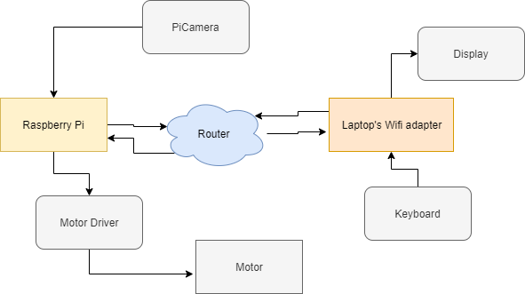
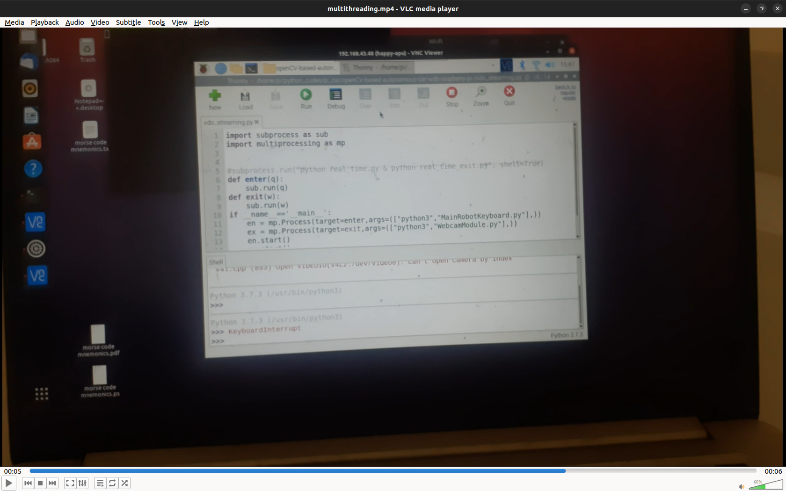
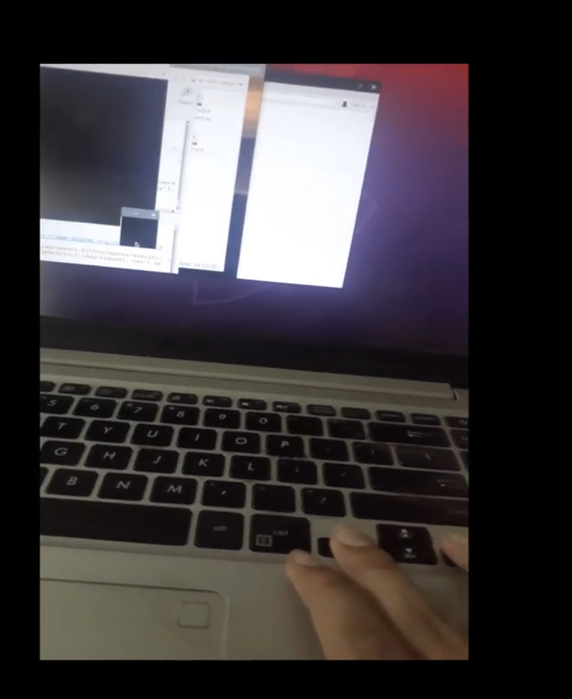
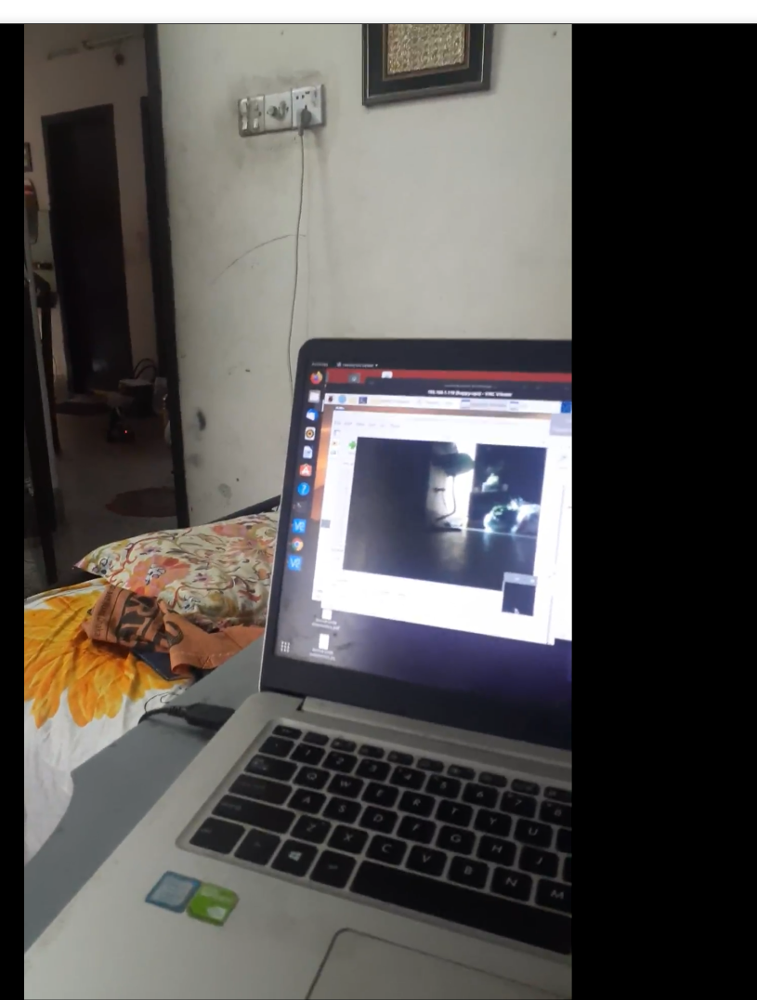
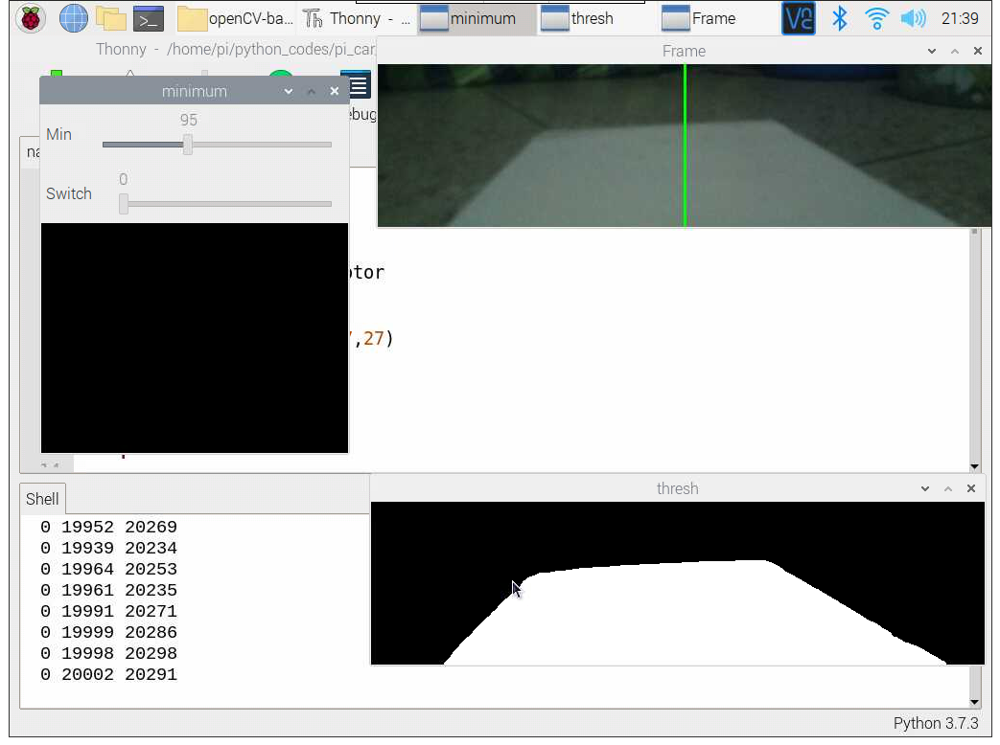
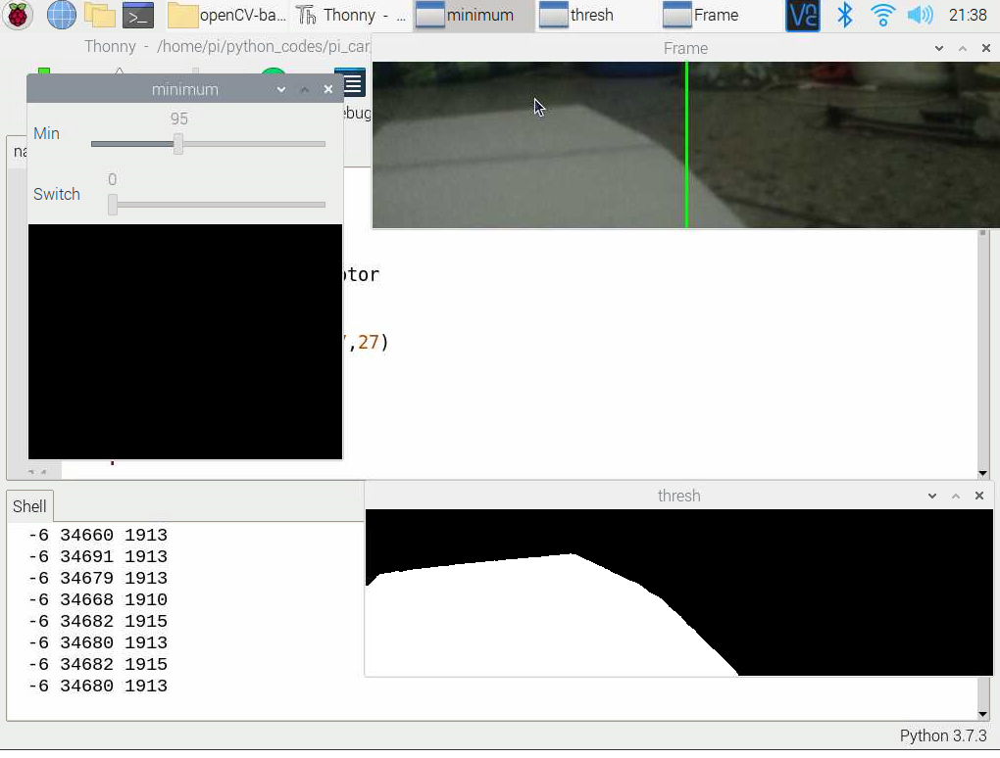
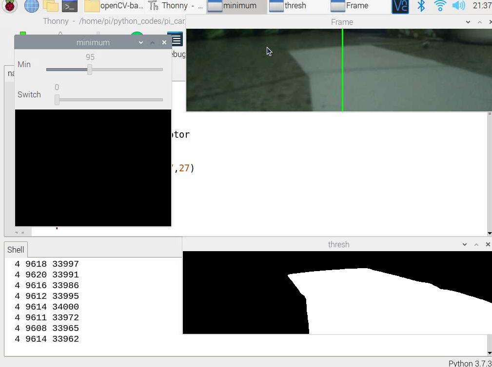
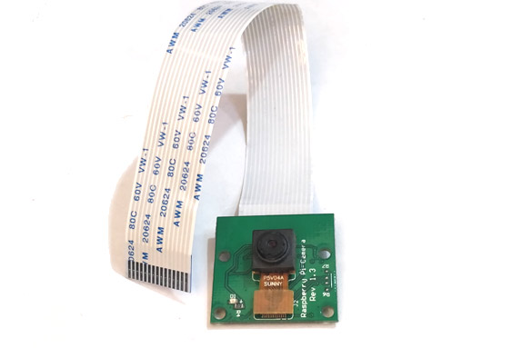
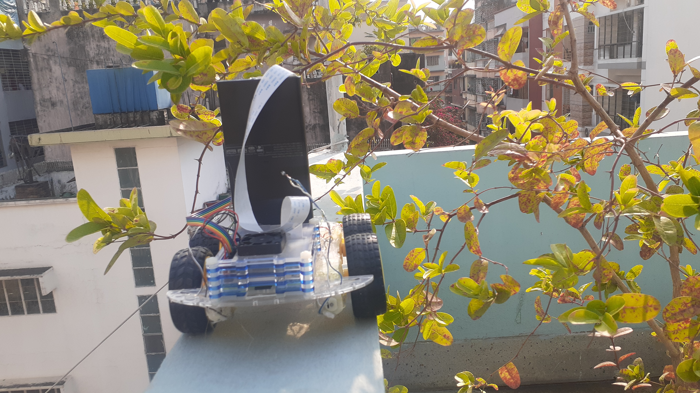

# OpenCV-Based Autonomous Car with Raspberry Pi

I built this project as a small Raspberry Pi robot that can be controlled locally and can also follow a track by itself. I used OpenCV for the image processing, Raspberry Pi GPIO for the motor control, and a camera module to collect the road view.

The project had two main parts:

1. **Local IoT control and video streaming:** I controlled the robot through a laptop and watched the camera feed while the camera and motor modules were running at the same time.
2. **Autonomous lane detection:** I processed the camera frames to find the white track lane and then sent steering commands to the motors.

Watch the [real-time project demonstration](https://youtu.be/_uvGQ6cCDds?si=tQSFqTP4Xs9REUO) on YouTube.

## 1. Local IoT control and video streaming

For the first part of the project, I used Python multiprocessing to run the control and camera functions as separate processes. The keyboard process reads local key presses and sends forward, backward, left, or right commands to the motors. At the same time, the camera process captures the live frames and shows the video on the screen.

I connected the laptop to the Raspberry Pi through the local network. In this setup, the car was controlled by keyboard input, while the camera feed allowed me to see what the car was seeing.



The source responsible for this part is:

- [`src/iot/vdo_streaming.py`](./src/iot/vdo_streaming.py) starts the keyboard-control and camera-preview processes.
- [`src/iot/keyboard_control.py`](./src/iot/keyboard_control.py) reads the arrow keys and commands the motors.
- [`src/vision/camera.py`](./src/vision/camera.py) captures, flips, resizes, and shows the Pi camera frames.
- [`src/hardware/motor.py`](./src/hardware/motor.py) converts speed values into GPIO direction and PWM signals.
- [`src/hardware/keyboard.py`](./src/hardware/keyboard.py) uses pygame to read keyboard input.

### Why multiprocessing was useful

Running the motor and camera code in the same loop can slow down control when image display or camera access blocks the program. In the code shown in my video, I used Python's `multiprocessing.Process` to start separate Python commands. The video title mentions multithreading, but the code shown here uses multiprocessing (separate processes), not Python threads:

```text
Process 1: keyboard input + motor control
Process 2: camera capture + live preview
```

This made the control and video display run concurrently. It was not a true network video server, but a local process-based video-viewing setup for controlling the robot over the local network.



The original files shown in the video were named `vdo_streaming.py`, `MainRobotKeyboard.py`, and `WebcamModule.py`. I reorganized the project but kept the launcher name so it is still familiar. The corresponding files now are:

| Name shown in the video | Current file |
|---|---|
| `vdo_streaming.py` | [`src/iot/vdo_streaming.py`](./src/iot/vdo_streaming.py) |
| `MainRobotKeyboard.py` | [`src/iot/keyboard_control.py`](./src/iot/keyboard_control.py) |
| `WebcamModule.py` | [`src/vision/camera.py`](./src/vision/camera.py) |

These are moved/renamed equivalents, so the video and current repository describe the same Part 1 setup. I also added screenshots of the local keyboard interaction and camera preview:

| Keyboard control | Camera preview |
|---|---|
|  |  |

## 2. Autonomous lane detection

In the second part, the robot had to follow the lane by itself. I first tried the traditional image-processing approach with HSV thresholding, a perspective transformation, histogram analysis, and a proportional controller.

At the beginning, the detected lane position sometimes changed continuously between frames. The changing values were noisy, and this made the steering values unstable. A small change in the road, camera angle, or white-light level could produce a different result. This was a problem for the motor because the robot received continuous and inconsistent steering values.

For the final lane-following implementation, I used a simpler method based on the number of white pixels on the left and right sides of the image.

### White-pixel approach

The final test code is in [`src/autonomous/pixel_lane_follower.py`](./src/autonomous/pixel_lane_follower.py). It works in this way:

1. Capture a camera frame.
2. Flip the frame and crop the lower part of the image.
3. Convert the cropped frame to grayscale.
4. Apply Gaussian blur and a binary threshold.
5. Draw a center line down the image.
6. Split the thresholded image into left and right halves.
7. Count the number of white pixels in each half.

The source code uses this calculation:

```python
curveVal = -1 * int((left_pixel - right_pixel) / 5000)
```

Here:

- `left_pixel` is the number of white pixels on the left side.
- `right_pixel` is the number of white pixels on the right side.
- Their difference is divided by `5000` to turn the large pixel count into a small steering value.

The steering part is implemented as follows:

```python
if curveVal > 0:
    motor.motor_control(speed * abs(curveVal), speed * abs(curveVal) // 11)
elif curveVal < 0:
    motor.motor_control((speed * abs(curveVal)) // 11, speed * abs(curveVal))
else:
    motor.motor_control(30, 30)
```

So, the logic is:

- If the left and right halves have almost the same number of white pixels, the lane is roughly centered and the car goes forward.
- If the right side has more white pixels, `left_pixel - right_pixel` becomes negative and `curveVal` becomes positive. The code gives the left motor more speed and the right motor less speed, so the car turns right.
- If the left side has more white pixels, `left_pixel - right_pixel` becomes positive and `curveVal` becomes negative. The code gives the right motor more speed and the left motor less speed, so the car turns left.

Differences smaller than `5000` pixels are treated as straight. The motor speed is intentionally reduced on the opposite side to make a simple differential turn. If the threshold finds no white pixels on either side, the motors stop instead of continuing forward.

### Original OpenCV lane-detection approach

The first lane-following module remains in [`src/vision/lane_detection.py`](./src/vision/lane_detection.py). It is based on:

1. Converting the frame to HSV.
2. Creating a white-lane mask.
3. Using trackbars to adjust the perspective points.
4. Warping the road to a top-down view.
5. Finding lane positions from histogram peaks.
6. Comparing the detected curve with the image center.
7. Averaging the curve over 10 frames.
8. Converting the curve to a value from `-1` to `1`.

I also made [`src/autonomous/lane_follower.py`](./src/autonomous/lane_follower.py) to use this curve value with proportional motor control:

```text
left_speed  = 20 + Kp * curve
right_speed = 20 - Kp * curve
```

The default `Kp` is `20`, and the motor speed is capped at `40` percent in that implementation.

## Lane test views

| Forward | Lane turning left | Lane turning right |
|---|---|---|
|  |  |  |

## Hardware

The robot is built with:

- Raspberry Pi 4
- Raspberry Pi Camera Module
- Motor driver board
- Two DC motors
- RC car chassis
- Battery or power bank
- Jumper wires and a ribbon cable
- Local network connection




The GPIO pins used in the code are:

| Motor side | Direction 1 | Direction 2 | PWM |
|---|---|---|---|
| Left | GPIO 10 | GPIO 22 | GPIO 9 |
| Right | GPIO 4 | GPIO 17 | GPIO 27 |

More hardware photographs are in [assets/components](./assets/components).

## Repository layout

```text
src/
├── iot/
│   ├── keyboard_control.py       Local keyboard motor control
│   └── vdo_streaming.py           Starts keyboard and camera processes
├── autonomous/
│   ├── lane_follower.py          Histogram/P-controller implementation
│   └── pixel_lane_follower.py    Final split-image white-pixel implementation
├── hardware/
│   ├── motor.py                  Motor GPIO and PWM control
│   └── keyboard.py               Pygame keyboard input
├── vision/
│   ├── camera.py                 Pi camera capture
│   ├── lane_detection.py         Lane-processing pipeline
│   └── image_utils.py            Warping, histogram, HSV, and display helpers
└── tools/
    └── hsv_color_picker.py       Interactive HSV calibration

assets/
├── diagrams/
├── components/
├── demos/
├── screenshots/
└── videos/
```

## Demo assets

### Track setup


### Robot prototype



There are also [test footage](./assets/videos/20210426_155543.mp4) and [other recorded video](./assets/videos/vid1.mp4).

## Installation

Run these commands on the Raspberry Pi:

```bash
sudo apt update
sudo apt install python3-opencv python3-pygame
python3 -m pip install -r requirements.txt
```

`RPi.GPIO` is Raspberry Pi-specific. It does not run on a normal computer without Raspberry Pi GPIO hardware.

## Running the project

Run the project from the repository root.

### Local keyboard control

```bash
python3 -m src.iot.keyboard_control
```

Controls:

- `UP`: move forward
- `DOWN`: move backward
- `LEFT`: turn left
- `RIGHT`: turn right
- `Ctrl+C`: exit

### Run control and camera processes together

```bash
python3 -m src.iot.vdo_streaming
```

This launcher uses two separate processes for keyboard control and camera preview.

### Autonomous lane follower

```bash
python3 -m src.autonomous.lane_follower
```

### Final white-pixel lane follower

```bash
python3 -m src.autonomous.pixel_lane_follower
```

### Camera preview

```bash
python3 -m src.vision.camera
```

Press `q` in the OpenCV window to exit.

### HSV calibration

```bash
python3 -m src.tools.hsv_color_picker
```

## Safety

- Lift the wheels or place the robot on a test stand before the first run.
- Start with low motor speed.
- Check the GPIO and motor-driver wiring before supplying power.
- Keep people and fragile objects away from the test area.
- Do not test the robot in traffic or another unsafe public place.

## Acknowledgments

This project was inspired by Murtaza's Workshop. I would like to thank Md. Iftekher Hossain Nabil vai and my friend Semonti for helping me during the development and video work.
